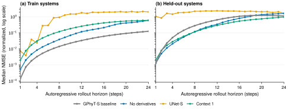
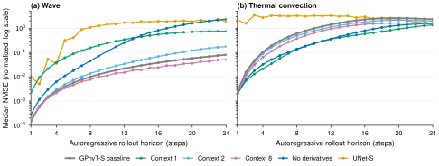

# Learning Shared Physical Dynamics on Synthetic Multiphysics Fields

**A reduced-scale, independent reproduction of
["Towards a Physics Foundation Model"](https://arxiv.org/abs/2509.13805).**

[](https://www.python.org/)
[](https://docs.astral.sh/uv/)
[](LICENSE)

[Paper](https://arxiv.org/abs/2509.13805) ·
[Original code](https://github.com/FloWsnr/General-Physics-Transformer) ·
[Released weights](https://huggingface.co/flwi/Physics-Foundation-Model) ·
[Detailed notes](REPRODUCTION.md)

> This is **not** the official implementation and is not affiliated with the
> original authors. It asks whether the core GPhyT design still works when the
> data, model, and compute are shrunk to a single T4 GPU on Google Colab (with a
> CPU fallback): a synthetic six-system corpus at 64x32, a 7.9M-parameter
> GPhyT-S, and 2,000 training steps. All seven reported training runs were
> executed on Colab T4 using the official Colab CLI. We also evaluate the
> released GPhyT-S/M/L/XL checkpoints zero-shot on a 256x128 version of the
> corpus.

## Headline findings

- **The residual/differentiator path is essential.** Removing it makes
  short-horizon predictions much worse and long rollouts diverge by orders of
  magnitude (24-step NMSE > 10<sup>4</sup>).
- **Held-out behavior is system-dependent.** `wave` and `thermal_convection`
  rank the variants differently, and the pooled held-out metric is dominated by
  thermal convection. Per-system results should be read separately.
- **Derivative channels are system-dependent at long horizons.** Removing them
  roughly doubles training loss and raises training h24 from 0.13 to 0.59. On
  held-out data it improves thermal h24 (2.327 -> 1.561) but destroys wave
  (0.081 -> 2.334), so the pooled held-out h24 rises from 1.17 to 1.62.
- **The transformer is more robust across systems, but UNet-S is best on thermal
  h24.** UNet-S is unstable on wave (1.90 at h24) but reaches 1.324 on thermal,
  narrowly ahead of Context 1 (1.359) and Context 8 (1.604).
- **Context length is a trade-off, and its ranking is system-specific.** Eight
  frames is best on wave (0.051 vs 0.081 for four frames) and on pooled held-out
  h24 (0.81 vs 1.17). On thermal it improves the baseline (2.327 -> 1.604) but
  Context 1 (1.359) and UNet-S (1.324) are lower. One frame is best on thermal
  h8 (0.133); Context 8 is best on wave h8 (0.0076).
- **Released-checkpoint scaling helps long rollouts, but not every system.** In
  zero-shot 256x128 rollouts, overall h24 falls from 1.001 (S) to 0.875 (M) to
  0.847 (L) to 0.680 (XL), and XL is also best at h8 (0.157). S remains best at
  h1 (0.00165) and on burgers and thermal convection. M shows a thermal h8
  spike (8.745) that largely resolves by h24 (1.170).

## Results



**GPhyT-S degrades gracefully; the ablations do not.** Median per-sample NMSE
over 24-step autoregressive rollouts on (a) the four training systems and
(b) the two held-out systems pooled together, all on Colab T4. Lower is better;
the y-axis is logarithmic. Each curve is a single seed. Direct prediction is
omitted because its h24 NMSE exceeds 10<sup>4</sup>; see
[REPRODUCTION.md](REPRODUCTION.md) for the full table.

The source data is in
[`docs/data/rollout_nmse_t4.csv`](docs/data/rollout_nmse_t4.csv) and the figure
is regenerated by [`docs/figures/results.py`](docs/figures/results.py).

### Held-out systems, separately



**Held-out behavior is system-dependent.** Median NMSE on (a) `wave` and
(b) `thermal_convection`; four test trajectories per system, one seed, log
y-axis. Context 8 is best on wave (0.051 vs 0.081 for the baseline). On thermal,
UNet-S is lowest at h24 (1.324), followed by Context 1 (1.359) and Context 8
(1.604), all below the baseline (2.327). The pooled held-out curve above is
dominated by thermal convection and hides these reversals. Direct prediction is
omitted because its h24 NMSE exceeds 10<sup>4</sup>; full per-system values are
in [REPRODUCTION.md](REPRODUCTION.md).

| Experiment | Wave h8 | Wave h24 | Thermal h8 | Thermal h24 |
|---|---:|---:|---:|---:|
| GPhyT-S baseline | 0.009971 | 0.080510 | 0.599894 | 2.326553 |
| Context length 1 | 0.156384 | 0.741876 | **0.133074** | 1.359496 |
| Context length 2 | 0.013679 | 0.175330 | 0.487037 | 1.956366 |
| Context length 8 | **0.007602** | **0.050953** | 0.372554 | 1.603582 |
| No derivative channels | 0.045338 | 2.334184 | 0.138929 | 1.561314 |
| UNet-S direct predictor | 1.095968 | 1.897055 | 3.250047 | **1.324035** |
| Direct prediction | 1.009101 | 32,984.237305 | 7.309248 | 222,188.148438 |

Best per column in bold. Per-system data:
[`docs/data/rollout_nmse_t4_per_system.csv`](docs/data/rollout_nmse_t4_per_system.csv);
generated by
[`docs/figures/build_data.py`](docs/figures/build_data.py), plotted by
[`docs/figures/heldout_systems.py`](docs/figures/heldout_systems.py). The earlier
CPU measurements are preserved in
[`docs/data/rollout_nmse_cpu.csv`](docs/data/rollout_nmse_cpu.csv).

### Released checkpoints at 256x128

Released GPhyT-S/M/L/XL checkpoints, evaluated zero-shot on our high-resolution
synthetic corpus with four input frames and a 24-step rollout:

| Model | Params | h1 | h8 | h24 | Eval time | Peak GPU |
|---|---:|---:|---:|---:|---:|---:|
| GPhyT-S | 7,992,773 | **0.001652** | 0.168915 | 1.000584 | 9.6 s | 0.12 GB |
| GPhyT-M | 111,597,317 | 0.004207 | 0.276754 | 0.874560 | 32.6 s | 0.57 GB |
| GPhyT-L | 384,885,765 | 0.001796 | 0.220459 | 0.846636 | 85.3 s | 1.67 GB |
| GPhyT-XL | 795,813,125 | 0.001880 | **0.156684** | **0.679890** | 156.5 s | 3.39 GB |

Per-system h24 medians:

| Model | Advection | Burgers | Incompressible NS | Sine-Gordon | Wave | Thermal |
|---|---:|---:|---:|---:|---:|---:|
| GPhyT-S | 1.609438 | **1.543170** | 0.093940 | 0.708727 | 0.888914 | **1.055033** |
| GPhyT-M | 1.705814 | 1.988563 | 0.047564 | 0.784912 | 0.826753 | 1.170085 |
| GPhyT-L | 1.490042 | 1.796777 | 0.058418 | 0.719075 | 0.779728 | 1.234888 |
| GPhyT-XL | **1.475180** | 1.826200 | **0.025760** | **0.545785** | **0.537446** | 1.346042 |

**Scaling helps long rollouts overall, but not uniformly.** XL is best overall at
h24 and h8; S remains best at h1 and on burgers and thermal convection. XL wins
four of six systems at h24 (advection, incompressible NS, sine-Gordon, and wave),
while S wins burgers and thermal convection. Thermal h24 degrades monotonically
with scale (1.055 -> 1.170 -> 1.235 -> 1.346), and M's thermal h8 spike (8.745)
largely resolves by h24 (1.170). Per-system medians use four test trajectories
per system. The 256x128 corpus has 4 train / 1 validation / 4 test trajectories
and 29 frames; normalization statistics come from its four training
trajectories. This is zero-shot synthetic-domain transfer, not a held-out split
of the released models' training data. Data:
[`docs/data/released_scaling_256.csv`](docs/data/released_scaling_256.csv).

## What is and is not reproduced

| Reproduced here | Not reproduced |
|---|---|
| A deterministic synthetic corpus of six 2D systems | The paper's 1.8 TB multi-physics corpus |
| GPhyT-S at 7.9M parameters | GPhyT-M/L/XL training |
| 2,000-step T4 runs via the official Colab CLI | ~1M-step training on 4xH100 |
| Controlled architecture/data ablations | The full benchmark suite and paper-scale metrics |
| Strict loading and zero-shot evaluation of released GPhyT-S/M/L/XL at 256x128 | Paper-scale benchmark numbers |

## Quickstart

### Google Colab (T4)

All reported results were produced with the official Colab CLI on a T4 runtime.
Install `google-colab-cli`, authenticate with `colab whoami`, then run:

```bash
colab new -s gphyt --gpu T4
colab exec -s gphyt -f scripts/colab_train.py --timeout 7200 \
  --env GPHYT_BRANCH=repro \
  --env GPHYT_DEVICE=cuda \
  --env GPHYT_STEPS=2000 \
  --env GPHYT_TAG=gphyt_s_baseline_colab
colab download -s gphyt \
  /content/gphyt-repro/results/repro/gphyt_s_baseline_colab/metrics.json \
  ./metrics.json
colab stop -s gphyt
```

The runner clones the public branch, installs the locked environment with
`uv`, generates the deterministic corpus if needed, trains, evaluates, and
prints the metrics. The first run on a fresh VM takes about 8 minutes including
environment setup and corpus generation; later runs reuse both and take about
3-5 minutes. To run every experiment variant sequentially on one T4 session:

```bash
colab new -s gphyt-all --gpu T4
bash scripts/colab_all.sh gphyt-all
colab stop -s gphyt-all
```

### Local CPU fallback

Requires [uv](https://docs.astral.sh/uv/). Python 3.13 is pinned in
`.python-version` and installed automatically.

```bash
git clone https://github.com/mahoutei/learning-shared-physical-dynamics-on-synthetic-multiphysics-fields
cd learning-shared-physical-dynamics-on-synthetic-multiphysics-fields
uv sync --locked

# Smoke test: 2/1/1 trajectories per system, ~1 min of training/eval.
uv run --locked python -m gphyt.repro.run \
  --data-dir corpus_smoke --smoke --tag smoke --output-dir results/smoke

# Full run: auto-generates the corpus if missing (~6 min), then 2,000 steps
# (~27 min on 8 CPU threads), followed by single-step and 24-step rollout eval.
uv run --locked python -m gphyt.repro.run
```

Outputs are written to `results/repro/<run_name>/` as `metrics.json` and
`model.pt`. The local default target is CPU; `--device cuda` works if a GPU is
available.

## Corpus

`gphyt/repro/systems.py` generates six 2D systems with a spectral solver.
Each system has 24 train / 4 validation / 4 test trajectories, 49 frames per
trajectory, on a 64x32 grid. Every frame carries five channels in The Well
layout: pressure, density, temperature, and two velocity components. Fields a
system does not use are zero.

| Split | System | Dynamics |
|---|---|---|
| train | `advection` | Steady cellular flow, passive scalar advection-diffusion |
| train | `burgers` | 2D viscous Burgers equation |
| train | `incompressible_ns` | Vorticity-streamfunction Navier-Stokes with Kolmogorov forcing |
| train | `sine_gordon` | Nonlinear sine-Gordon wave equation |
| held-out | `wave` | Linear wave equation (exact Fourier propagator) |
| held-out | `thermal_convection` | Boussinesq thermal convection |

The corpus is deterministic. `gphyt/repro/corpus.py` writes the HDF5 files and
computes z-score statistics:

```bash
uv run --locked python -m gphyt.repro.corpus --root ~/.cache/gphyt_repro/corpus
```

`scripts/eval_corpus.py` builds a separate 256x128 evaluation-only corpus for
the released checkpoints; it uses 4 train / 1 validation / 4 test trajectories
and 29 frames per trajectory.

## Experiment tree

| Node | Change from baseline | Status |
|---|---|---|
| `GPhyT-S baseline` | — (4 frames, derivatives, residual Euler update) | done |
| `Ablation: direct prediction` | `residual: false` | done |
| `Ablation: no derivative channels` | `use_derivatives: false` | done |
| `Baseline: UNet-S` | `architecture: unet` | done |
| `Context length 1 frame` | `n_steps_input: 1` | done |
| `Context length 2 frames` | `n_steps_input: 2` | done |
| `Context length 8 frames` | `n_steps_input: 8` | done |

Each experiment is a branch named `orx/<slug>`; every branch records the exact
code that produced its run. The `repro` branch is this publication branch. All
seven variants were run on Colab T4; [`scripts/colab_all.sh`](scripts/colab_all.sh)
reproduces the batch.

## Repository layout

```
gphyt/repro/          Corpus generators, Well writer, config, train/eval entry
scripts/              Colab CLI runners for training and released-checkpoint eval
docs/data/            Raw rollout NMSE measurements (CPU, T4, and released CSVs)
docs/figures/         Figures, extraction/plotting scripts, vendored style module
docs/upstream-readme.md  Original project README, preserved for attribution
REPRODUCTION.md       Full protocol, results table, and limitations
```

## Limitations

- Synthetic 64x32 data and 2,000 steps are far below the paper's scale; the
  absolute NMSE values are not comparable to the paper's benchmarks.
- One seed per configuration. Differences of a few percent should not be
  over-interpreted; per-system medians use four test trajectories, so
  system-level rankings are especially noisy. Free-tier Colab availability also
  varies between sessions.
- `advection` and `thermal_convection` are the hardest systems at long horizons;
  their errors may reflect data difficulty as much as architecture.
- The released-checkpoint evaluation uses a reduced 4/1/4, 29-frame 256x128
  corpus with normalization statistics from its four training trajectories, not
  the paper's data or the checkpoints' original training statistics. It is
  zero-shot synthetic-domain transfer, not a held-out split of the released
  models' training data.

## Citation

If you use the original model or data, cite the paper:

```bibtex
@article{wiesner2025towards,
  title   = {Towards a Physics Foundation Model},
  author  = {Wiesner, Florian and Gray, Zo{\"e} J. and Wessling, Matthias and Baek, Stephen},
  journal = {arXiv preprint arXiv:2509.13805},
  year    = {2025},
  note    = {ICML-AI4Physics 2026}
}
```

## License

MIT. The original code and weights are by Florian Wiesner et al.; see
[LICENSE](LICENSE) and [docs/upstream-readme.md](docs/upstream-readme.md).
