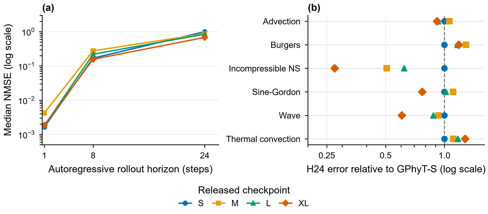
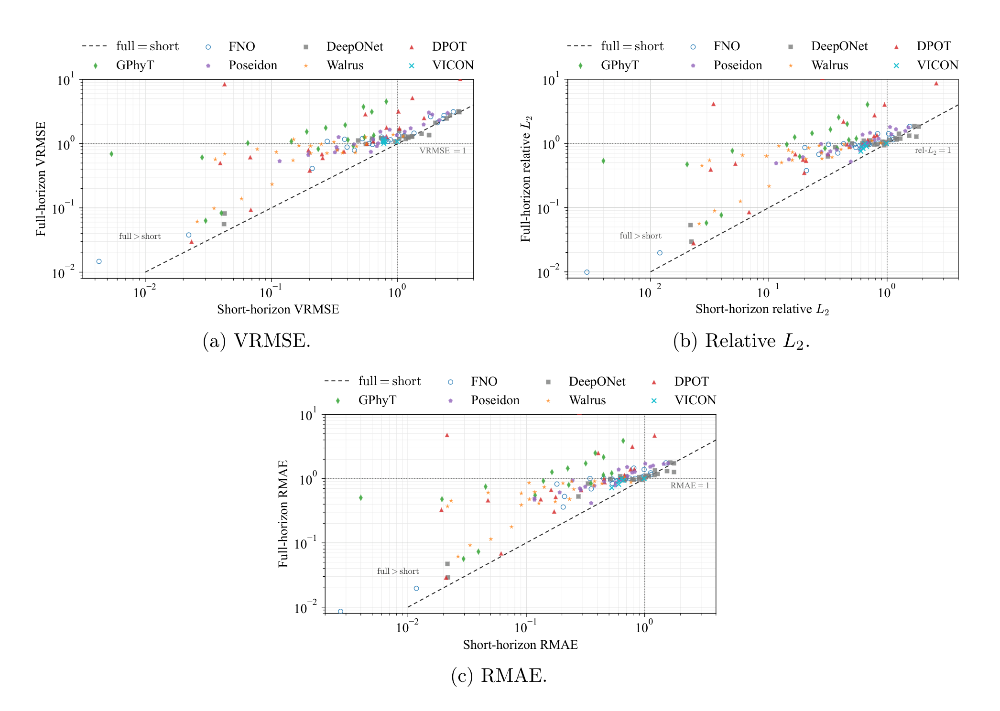
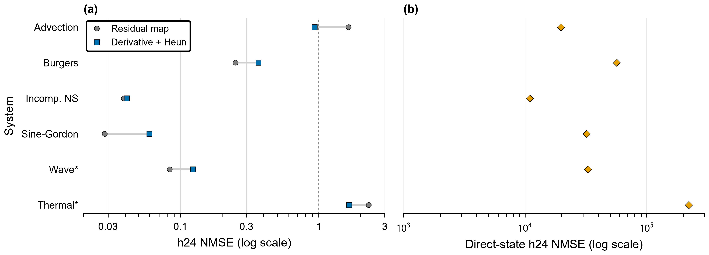
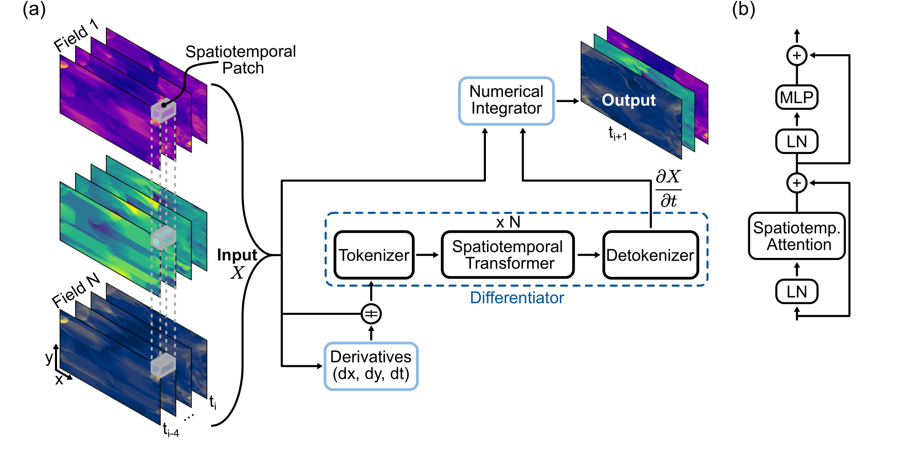
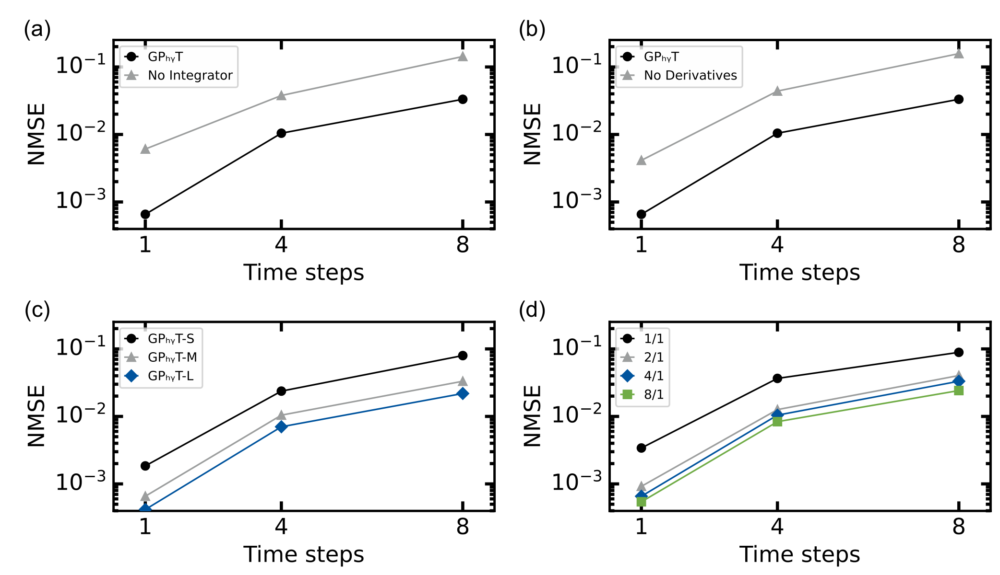
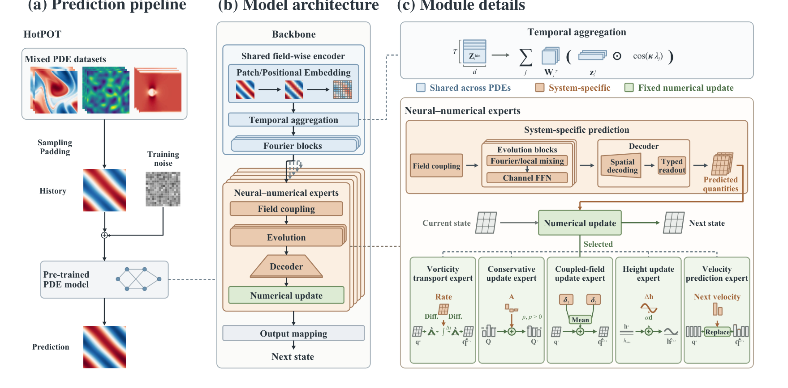
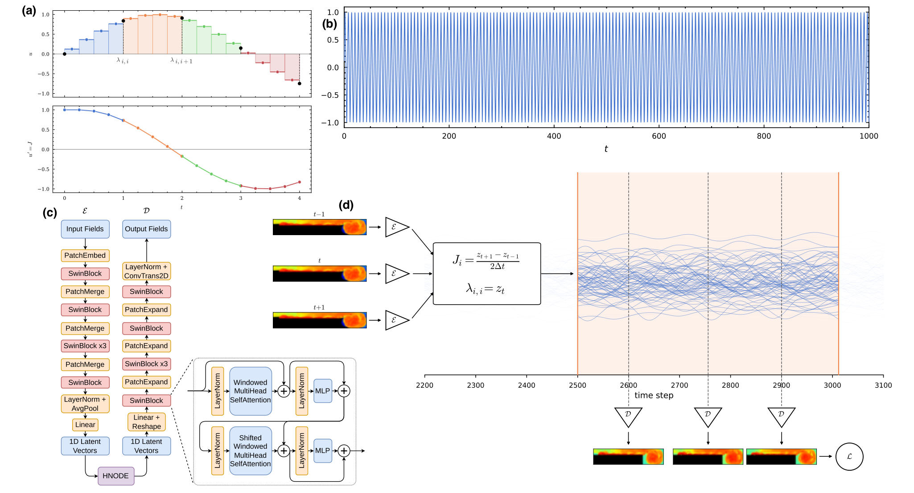
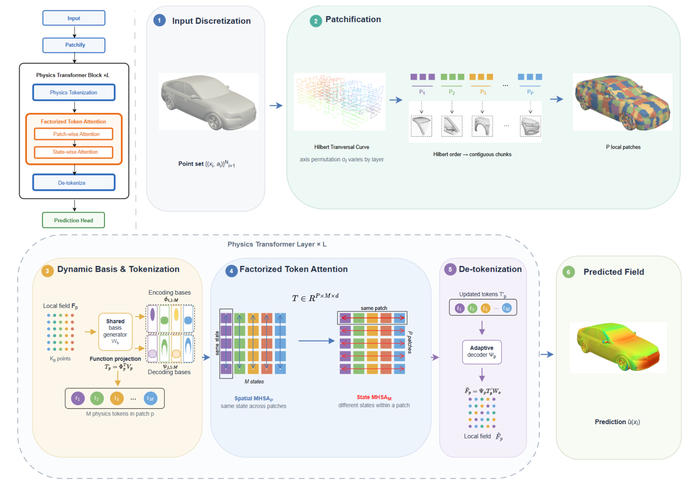
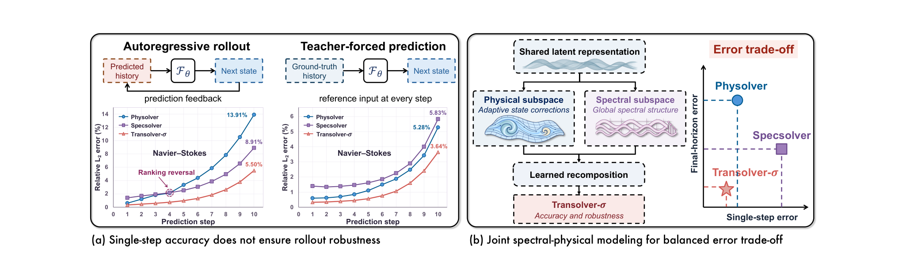

# What GPhyT Actually Learns, and What to Build Next

**A reduced-scale reproduction and literature-grounded architecture review**

Project: *Towards a Physics Foundation Model*<br>
Date: 11 November 2026<br>
Code base: `orx/released-scaling-eval` at `fdcb069`; integrator arm at `orx/derivative-heun-integrator` `59ea8bf`

---

## Executive summary

The most consequential finding is not a benchmark number. It is that the released GPhyT implementation does **not** compute the architecture described in the paper. The paper presents a neural differentiator that predicts \(\partial X/\partial t\), followed by a numerical integrator. The released forward pass instead computes a residual next-state update, `delta + x`, returns only the last frame, never calls the integrator it constructs, and ignores the `step_size` argument. The same forward pass is present on `upstream/main` of the official code repository, so this is not an artifact of our fork.

That mismatch changes how the paper's ablations should be read. The “direct next-state prediction” arm is a valid but weak baseline: with `residual: false`, the same network must learn the absolute normalized state without the identity shortcut. In our runs it optimized much more slowly and became unstable over long rollouts. That is evidence about optimization and rollout stability, not a units/offset bug. The paper's Figure 5a may have been produced by a different code path; the public code does not isolate the claimed derivative-versus-direct comparison cleanly, because the residual model is not a trained derivative model.

The reduced-scale evidence is nonetheless useful. At 256×128, scaling from GPhyT-S to GPhyT-XL lowers overall median h24 NMSE from 1.001 to 0.680, but the gain is strongly system-dependent: incompressible Navier–Stokes improves by 73%, wave by 40%, and sine–Gordon by 23%, while thermal convection gets 28% **worse** and Burgers 18% worse. GPhyT-S remains best at h1. Thermal convection degrades monotonically with scale. This is not a simple “more parameters solve multi-physics” story; it is a system-conditioning and rollout-reliability story.

The literature points to four concrete directions:

1. **Make the numerical scaffold real.** HotPOT pairs learned predictors with fixed, PDE-specific numerical updates; the Hybridizable Neural Time Integrator embeds a transformer in a structure-preserving finite-element scheme with stability guarantees. Both suggest that the missing integrator is not cosmetic.
2. **Replace fixed grid tokenization with function-aware tokens and factorized attention.** Physics Transformer uses adaptive local bases and factorized spatial/state attention; Transolver-σ separates physical and spectral subspaces and reports large rollout gains.
3. **Optimize and evaluate for the rollout, not the one-step target.** Beyond Local Accuracy finds full-horizon VRMSE exceeds short-horizon VRMSE in 140/144 paired configurations, with median amplification 2.04. Transolver-σ shows a teacher-forced ranking reversal.
4. **Use system-specific capacity without giving up a shared model.** HotPOT's 17M heterogeneous-expert model beats substantially larger homogeneous mixture-of-experts models. Our thermal-versus-wave trade-off is exactly the failure mode that motivates typed experts or adapters.

The highest-value next experiment was therefore not a bigger model. It was a clean, three-arm test at 64×32: (i) the current residual map, (ii) a derivative-parameterized network with Heun or multi-substep Euler (one-step Euler is algebraically identical to the residual map), and (iii) a stronger direct-state baseline with a fair initialization and budget. The derivative-plus-Heun arm is now complete. It lowers pooled held-out h24 NMSE from 1.147 to 0.907 and held-out h1 from 0.00130 to 0.00070, mainly by improving thermal convection (2.292→1.656) and advection (1.643→0.933). But it regresses wave, Burgers, sine–Gordon, and incompressible Navier–Stokes, and worsens train h24 (0.127→0.178). That is a narrow, system-specific survival of the integrator hypothesis, not a clean win. Replicate it and test last-frame-only Heun or multi-substep Euler before scaling.

---

## 1. What the released code actually computes

### 1.1 The forward pass

The core path is in `gphyt/models/transformer/model.py:224-245`:

```python
def differentiate(self, x):
    if self.use_derivatives:
        dt, dh, dw = self.derivatives(x)
        x = torch.cat([x, dt, dh, dw], dim=-1)
    x = self.tokenizer(x)
    if self.init_pos_encodings is not None:
        x = self.init_pos_encodings(x)
    x = self.attention_blocks(x)
    x = self.detokenizer(x)
    return x

def forward(self, x, step_size=1.0):
    out = self.differentiate(x) + x
    return out[:, -1, ...].unsqueeze(1)
```

The network output is added to the input and the last frame is returned. This is a residual next-state map. With a learned derivative field \(f\), forward Euler at \(\Delta t = 1\) gives \(x + f(x)\); the residual map is therefore *algebraically identical* to Euler when the same network output is treated as the derivative. It is not implemented as integration, and the distinction only becomes substantive with a higher-order integrator or multiple substeps:

An equivalence check with shared weights confirms this: Euler at \(\Delta t = 1\) and the residual forward produce identical outputs (maximum absolute difference 0.0), while Heun differs (maximum absolute difference 0.1116 on a randomly initialized model). One-step Euler is therefore a relabeling, not an independent integration ablation.

- `self.integrator` is constructed at `model.py:160-167` and never called.
- `step_size` is accepted at `model.py:243` and unused.
- The differentiator sees the whole four-frame history, not a single state. The `Euler`, `Heun`, and `RK4` classes in `gphyt/models/transformer/num_integration.py` expect a derivative callable on one state. Wiring them in is therefore not a one-line change; the history conditioning has to be preserved.
- There is no derivative target. The loss is next-state MSE over autoregressive steps (`gphyt/repro/run.py:361-371`). In the residual configuration the network is trained to output an increment that, when added to the current state, matches the next state. In the direct configuration the same output is supervised as the next state itself.

The distinction matters for three reasons. First, a residual map trained with next-state supervision can be a perfectly good model; the issue is that the paper's scientific claim is about derivative learning plus integration, and that claim is not tested by this code. Second, the `dt_stride` knob changes the temporal spacing of training samples, but the model receives no \(\Delta t\) token and the finite-difference features are not scaled by it. Third, higher-order integrators cannot be evaluated by merely changing a config string; they require evaluating the learned derivative at intermediate states.

### 1.2 The “direct prediction” baseline is weak, not invalid

`gphyt/repro/run.py:46-54` defines:

```python
class DirectPrediction(nn.Module):
    def forward(self, x):
        return self.model.differentiate(x)[:, -1, ...].unsqueeze(1)
```

`differentiate` returns the detokenizer output, a five-channel field. With `residual: false`, that output is the predicted next state, and the next-state loss supervises it directly. There is no delta/state unit mismatch. The reason the arm performs poorly is optimization and stability: the network must learn absolute normalized states, while the residual arm starts from the identity map and only has to learn an increment. The direct arm still reached a finite h1 error, then amplified one-step errors over the rollout.

A stronger direct baseline would train a state head from scratch with an initialization or normalization scheme designed for absolute states, and with a matched optimization budget. The existing scratch run is therefore a legitimate but weak baseline, not an invalid one. It does not by itself establish that derivative prediction beats direct prediction.

### 1.3 Paper versus code

| Claim in the paper | What the paper says | What the released code does | Consequence |
|---|---|---|---|
| Neural differentiator | Predicts \(\partial X/\partial t\), then integrates | Output is supervised as \(\Delta X\); no derivative target | The model is a residual next-state predictor, not a trained differentiator |
| Numerical integrator | Euler, with Heun/RK4 options ([GPhyT §3.1, pp. 3–4](https://www.alphaxiv.org/abs/2509.13805)) | Integrator object constructed, never called; `step_size` ignored | No integration ablation is possible without code changes |
| Direct next-state baseline | Compared against derivative prediction in Fig. 5a | `DirectPrediction` is a valid state head but receives no identity shortcut | The arm is weak and unstable; it is not a clean test of the paper's claim |
| Derivative features | Central differences improve sharp gradients (Fig. 5b) | Fixed grid-unit stencils concatenated to the input | Supported in principle, but system-dependent in our scratch runs |
| Unified spatiotemporal attention | Chosen over factorized attention for expressivity | Full attention over all tokens | Matches the paper |
| Absolute positional encoding | Learned absolute encodings | Learned per-grid-position tensor | Matches the paper, but ties the model to a fixed resolution |
| Long-horizon stability | Claimed as a strength, with limitations noted | Rollout is autoregressive but training loss uses two steps | Training and evaluation horizons are mismatched |

Two additional code-level observations are relevant.

**Redundant query/key/value projection.** `AbstractAttention` first applies `to_qkv` (`attention.py:33-35`), then passes the resulting q, k, v into `nn.MultiheadAttention`, which applies its own input projection (`attention.py:37-44`, `:96-102`). The composition is an extra linear map and extra parameters. With absolute positional encodings this is merely wasteful; with RoPE it is more serious, because the rotary rotation is applied *before* the second learned projection, which can destroy the relative-position property RoPE is meant to provide. We infer the RoPE issue from the code path; it should be verified with an attention-equivalence test before changing it.

**Fixed grid-unit derivatives.** `FiniteDifference` uses filters `[-1, 0, 1]` or `[1/12, -2/3, 0, 2/3, -1/12]` with replicate padding and no scaling by grid spacing or \(\Delta t\) (`gphyt/models/transformer/derivatives.py:36-67`). At 64×32 and 256×128 the same stencil has different physical meaning. With `dt_stride` in `[1, 4]`, the temporal derivative feature also changes meaning across samples. The model has no way to know which spacing produced the feature. This is a low-cost, high-value thing to fix: pass \(\Delta t\), \(dx\), and \(dy\) as scalars or embeddings, and scale the finite differences accordingly.

### 1.4 Tokenization and attention budget

The tokenizer is a single `Conv3d` over non-overlapping tubelets (`gphyt/models/tokenizer/tokenizer.py:167-177`). With `patch_size: [1, 16, 16]` and four input frames:

- 64×32 input: \(4 \times 4 \times 2 = 32\) tokens.
- 256×128 input: \(4 \times 16 \times 8 = 512\) tokens.
- Full attention at 512 tokens is \(512^2\) per layer; at 1024×512 it would be 8192 tokens and 67M attention entries per layer.
- Absolute positional embeddings are a learned tensor of shape `(1, T, H, W, C)` (`pos_encodings.py:39-40`), so the model cannot change resolution without interpolating or retraining that tensor.

The paper chose full attention deliberately to capture non-separable phenomena such as turbulence and shocks. That is defensible at 512 tokens. It is not a path to variable resolution or 3D. Physics Transformer's function-projection tokens and Transolver-σ's factorized spectral/physical subspaces are the relevant alternatives, not because full attention is wrong at this scale, but because it is the wrong scaling axis for the next stage.

### 1.5 What the model does not see

The input is fields plus finite differences. It does not receive:

- a boundary mask, signed distance, or geometry support;
- coordinates;
- a \(\Delta t\) or grid-spacing token;
- a field-type embedding (pressure, density, temperature, velocity components are concatenated and mixed by the first convolution);
- a system-family token.

HotPOT's shared encoder explicitly uses coordinates, boundary distance, geometry support, and validity masks ([HotPOT §4.1, p. 4](https://www.alphaxiv.org/abs/2610.38218)). The GPhyT paper claims generalization to new boundary conditions, but the released model has no explicit boundary representation; it must infer boundaries from field values. That is possible, but it is an inductive bias the paper does not test. Adding a boundary mask and coordinate channels is a cheap ablation with a clear hypothesis.

---

## 2. What the reduced-scale evidence says

### 2.1 Released-checkpoint scaling at 256×128

The released checkpoints were evaluated on the project's six-system 256×128 corpus, with four input frames and 24 rollout steps. The corpus has four test trajectories per system, and the table reports medians; there are no per-sample arrays or confidence intervals. The evaluation is a zero-shot transfer of released weights to our reduced corpus, not a reproduction of the paper's 1.8 TB training run.

| Model | Parameters | h1 NMSE | h8 NMSE | h24 NMSE | Peak GPU | Eval time |
|---|---:|---:|---:|---:|---:|---:|
| GPhyT-S | 7.99M | 0.00165 | 0.1689 | 1.0006 | 0.12 GB | 9.6 s |
| GPhyT-M | 111.6M | 0.00421 | 0.2768 | 0.8746 | 0.57 GB | 32.6 s |
| GPhyT-L | 384.9M | 0.00180 | 0.2205 | 0.8466 | 1.67 GB | 85.3 s |
| GPhyT-XL | 795.8M | 0.00188 | 0.1567 | 0.6799 | 3.39 GB | 156.5 s |

**Figure 1** shows the same data as trajectories and as h24 error relative to GPhyT-S for each system.



*Figure 1. Scale improves long-horizon error on average but not uniformly. (a) Median NMSE over the six-system corpus at rollout horizons 1, 8, and 24 for the four released checkpoints. (b) H24 median NMSE for each system divided by the corresponding GPhyT-S value; below 1 is better than S, above 1 is worse. Four test trajectories per system, medians only, single checkpoint per size; no confidence intervals. Data: `data/released_scaling_256.csv`.*

The pattern is more informative than the aggregate:

- **Overall h24:** XL is 32% better than S (0.680 vs 1.001). L is 15% better, M is 13% better.
- **Short horizon:** S is best at h1; XL is 14% worse than S at h1, and M is 2.5× worse. Scaling does not improve one-step accuracy at this evaluation.
- **System dependence at h24:** XL improves incompressible NS by 73%, wave by 40%, sine–Gordon by 23%, and advection by 8%; it worsens thermal convection by 28% and Burgers by 18%.
- **Thermal monotonicity:** thermal h24 goes 1.055 (S) → 1.170 (M) → 1.235 (L) → 1.346 (XL). This is a consistent negative scaling trend, not noise from one checkpoint.
- **Non-monotonic middle:** M is worse than S at h1 and h8 but better at h24. With one checkpoint per size, capacity and optimization/checkpoint quality are confounded.

The h24 values also cross the normalized-mean threshold of 1.0 for several systems. At h24, S is at or above 1 on advection, burgers, and thermal; XL is above 1 on advection, burgers, and thermal. Reporting a single overall median hides that some systems are not merely inaccurate but worse than a mean-field predictor.

This is the same phenomenon documented by **Beyond Local Accuracy**: short-horizon rankings do not determine full-rollout reliability. The paper evaluates seven PDE foundation models on seven datasets and finds full-horizon VRMSE exceeds short-horizon VRMSE in 140 of 144 paired trained configurations, with median error amplification \(G = 2.04\). The count of configurations below VRMSE 1 falls from 104 at the short horizon to 53 at the full horizon, and 12 full rollouts exceed 10 although none does at the short horizon ([Beyond Local Accuracy, p. 1](https://www.alphaxiv.org/abs/2610.31935)).



*Figure 2. Short-horizon accuracy is a poor proxy for rollout reliability. Each point is a model–dataset–budget configuration; points above the dashed line have larger full-horizon than short-horizon error. The panel shows VRMSE, relative \(L_2\), and relative MAE. Source: Beyond Local Accuracy, Fig. 1, p. 9; reproduced for commentary with attribution.*

### 2.2 Scratch 64×32 ablations

The scratch runs use a synthetic six-system corpus at 64×32, four input frames, and rollout to h24. They were run on T4 and are useful for architecture screening, not for claims about the paper's scale.

| Variant | Thermal h24 | Wave h24 | Held-out median h24 |
|---|---:|---:|---:|
| GPhyT-S baseline | 2.327 | 0.0805 | 1.204 |
| No derivatives | 1.561 | 2.334 | 1.948 |
| Context 1 | 1.359 | 0.742 | 1.051 |
| Context 2 | 1.956 | 0.175 | 1.066 |
| Context 8 | 1.604 | 0.0510 | 0.827 |
| UNet-S | 1.324 | 1.897 | 1.611 |
| Direct prediction | 222,188 | 32,984 | 127,586 |

The held-out column is the median of the two held-out system medians (wave and thermal), not a sample-pooled median.

The table is a warning against universal architectural claims:

- Removing derivative features helps thermal by 33% but destroys wave (0.081 → 2.334). Derivative features are not uniformly useful; their value depends on the system's smoothness and the resolution.
- Context 8 gives the best held-out median h24 (0.827 vs 1.204 for the baseline), but thermal is better with context 1 (1.359) than context 8 (1.604), while wave is much better with context 8 (0.051) than context 1 (0.742). More context is not uniformly better either.
- UNet-S is the best thermal model in this table (1.324) but is unstable on wave (1.897). A convolutional inductive bias helps a smooth thermal field and hurts a wave field.
- The direct-prediction numbers are the weak baseline described in §1.2; the long-horizon collapse reflects optimization and rollout stability, not a units mismatch.

These results are single-seed, four-trajectory medians. They are hypothesis-generating, not confirmatory.

#### Aligned forecast-start evaluation

The seven saved seed-0 checkpoints were scored on a single Colab T4. Each of the 24 test trajectories supplied frames 0–7 as available history and frames 8–31 as targets. Each model received only its configured trailing context. The evaluator used the existing local copy of the 64×32 synthetic corpus and verified shared target hashes and finite errors through h24. The original Colab VM's corpus hash is unavailable, so changes from the historical scores cannot be attributed to forecast alignment alone.

The held-out aggregate below pools the eight held-out trajectories before taking the median. The historical column is recomputed from the saved metrics using that same aggregation. The preceding table uses the median of the two system medians.

| Variant | Historical held-out h24 | Aligned train h24 | Aligned held-out h24 | Wave h24 | Thermal h24 |
|---|---:|---:|---:|---:|---:|
| GPhyT-S, 4 frames | 1.1690 | 0.1345 | 1.0016 | 0.0749 | 1.9368 |
| GPhyT-S, 1 frame | 0.9740 | 0.5134 | 0.9586 | 0.5313 | 1.3967 |
| GPhyT-S, 2 frames | 1.0224 | 0.1810 | 0.8258 | 0.1641 | 1.4540 |
| GPhyT-S, 8 frames | 0.8116 | 0.1431 | 0.8067 | 0.0510 | 1.5937 |
| No derivative channels | 1.6208 | 0.5737 | 1.4999 | 2.4699 | 1.4914 |
| U-Net-S | 1.6623 | 2.0319 | 1.4453 | 1.8129 | 1.0570 |
| Direct prediction | 119,636.0527 | 27,857.4629 | 84,240.3564 | 27,755.6494 | 145,090.8438 |

GPhyT-S, 8 frames leads the pooled held-out context comparison (0.8067), followed by GPhyT-S, 2 frames (0.8258). Carry the leading context forward as a held-out candidate and keep four frames as the integrator comparison control. This ranking comes from one training seed and four test trajectories per system.

Data: [per-trajectory NMSE](data/aligned_trajectory_nmse.csv), [median NMSE](data/aligned_median_nmse.csv), and [runtime metadata](data/aligned_runtime.json).

### 2.3 Three-arm integrator test at 64×32

The scratch table above is a T4 screening run. To compare the residual map, a derivative-plus-integrator arm, and the direct-state baseline on identical hardware, we ran all three at 64×32 on CPU with the same 7.9M-parameter GPhyT-S backbone, four input frames, 2,000 steps, and one seed. The derivative-plus-Heun arm interprets the network output as \(\partial X/\partial t\), applies one Heun step with \(\Delta t = 1\), and trains only through the integrated state loss. It has no explicit derivative target.

| Variant | Advection | Burgers | Incomp. NS | Sine–Gordon | Wave* | Thermal* |
|---|---:|---:|---:|---:|---:|---:|
| Residual map | 1.643 | 0.250 | 0.039 | 0.028 | 0.0838 | 2.292 |
| Derivative + Heun | 0.933 | 0.366 | 0.041 | 0.0597 | 0.123 | 1.656 |
| Direct state | 19,758 | 56,696 | 10,921 | 32,148 | 32,984 | 222,360 |

*H24 median NMSE by system; asterisks mark held-out systems. Single seed, four trajectories per system. The residual and Heun arms share the same backbone and budget; direct state is the existing `residual:false` wrapper. Exact values are in `data/three_arm_cpu.csv`.*



*Figure 3. A derivative-plus-Heun arm helps thermal convection and advection but regresses the other four systems at h24. Panel (a) compares the residual map with derivative + Heun; panel (b) shows the direct-state arm on a separate log scale. Values are h24 median NMSE, single seed. Asterisks mark held-out systems.*

At the aggregate level, Heun lowers pooled held-out h24 NMSE from 1.147 to 0.907 and held-out h1 from 0.00130 to 0.00070. The gain is concentrated: thermal falls from 2.292 to 1.656 and advection from 1.643 to 0.933. But wave rises from 0.0838 to 0.123, Burgers from 0.250 to 0.366, sine–Gordon from 0.0284 to 0.0597, and incompressible Navier–Stokes from 0.0390 to 0.0410. Train h24 also worsens, from 0.127 to 0.178.

Under the decision rule in §4, the arm meets the literal two-of-six condition (advection and thermal) and improves h1, so the integrator hypothesis survives narrowly. It is not a clean win: four of six systems regress, train h24 worsens, and the result is one seed. The direct-state arm is far worse (held-out h24 119,327, held-out h1 0.545), consistent with §1.2, but it remains a weak baseline rather than a fair direct-state test. The current Heun implementation also applies the update to the whole four-frame window, not only the last frame; a last-frame-only variant is a follow-up.

These results are enough to reject a large uniform gain and to justify a replication. They are not enough to justify a 256×128 scale-up. The residual, direct-state, and Heun runs are `21a41522`, `b63110a1`, and `f3f30768`; the Heun code is commit `59ea8bf` on `orx/derivative-heun-integrator`.

---

## 3. What the literature suggests

### 3.1 The numerical scaffold is the missing inductive bias

The GPhyT paper's own architecture figure shows the differentiator producing \(\partial X/\partial t\) and a numerical integrator producing \(X_{t+1}\) ([GPhyT Fig. 1, p. 4](https://www.alphaxiv.org/abs/2509.13805)). The paper's Fig. 5a compares GPhyT with a “No Integrator” variant and reports lower errors for GPhyT across horizons; the text describes the comparison as direct next-state prediction. The released code has no separate integrator to remove. The paper also reports that removing derivative features degrades extended rollouts by nearly an order of magnitude ([GPhyT Fig. 5 and §A.1, p. 12](https://www.alphaxiv.org/abs/2509.13805)).



*Figure 4. The paper's GPhyT pipeline. A spatiotemporal transformer is the neural differentiator; its output \(\partial X/\partial t\) is passed to a numerical integrator to produce the next state. The released forward pass omits the integrator and supervises a residual next-state update instead. Source: GPhyT, Fig. 1, p. 4.*



*Figure 5. The paper's ablation: GPhyT versus “No Integrator” and “No Derivatives”, plus model-size and context-length sweeps. The “No Integrator” comparison is the one our code cannot reproduce faithfully, because the released model has no separate integrator to remove; our direct-prediction arm removes the identity shortcut and is a weak but valid state predictor. Source: GPhyT, Fig. 5, p. 12.*

Two recent papers offer concrete alternatives to the missing scaffold.

**HotPOT** keeps a shared history encoder but gives each PDE family a neural–numerical expert: a learnable predictor outputs the quantities required by a fixed, PDE-specific numerical update with no trainable parameters ([HotPOT, pp. 1–4](https://www.alphaxiv.org/abs/2610.38218)). The update can be a transport rate, a conservative-variable action, a height increment, a concentration proposal, or a velocity prediction. The shared encoder and predictors are trained end-to-end with next-state supervision. Across five PDE families and six settings, HotPOT reduces rollout error by 50.7% on average relative to MoE-POT across 24 matched-scale comparisons, and its 17M model outperforms substantially larger MoE-POT models ([HotPOT, p. 1](https://www.alphaxiv.org/abs/2610.38218)).



*Figure 6. HotPOT's shared encoder and PDE-family neural–numerical experts. The predictor is learned; the numerical update is fixed and system-specific. This is the cleanest existing template for “one shared model, many physical update rules.” Source: HotPOT, Fig. 2, p. 4.*

**The Hybridizable Neural Time Integrator** goes further: it embeds an autoregressive transformer inside a mixed finite-element exterior-calculus scheme, with temporal mortars coupling rollout domains. The construction preserves discrete energies and admits uniform gradient bounds independent of rollout length ([Hybridizable Neural Time Integrator, pp. 1–4](https://www.alphaxiv.org/abs/2604.21101)). On Lorenz it forecasts for 10,000 Lyapunov times; on the shear-flow benchmark it reports 2–3× lower VRMSE than PhysiX with 65× fewer parameters; on a pulsed-power fusion component it trains from 12 simulations and reports a 9,000× speedup ([same, pp. 1, 8](https://www.alphaxiv.org/abs/2604.21101)).



*Figure 7. The Hybridizable Neural Time Integrator embeds learned dynamics in a mixed finite-element scheme with mortars that enforce continuity and energy transfer across rollout domains. The architecture is heavier than GPhyT, but it is the strongest existence proof that numerical structure can substitute for data scale. Source: Hybridizable Neural Time Integrator, Fig. 1, p. 4.*

The lesson is not “copy the finite-element machinery.” It is that **the update rule is part of the model**, not an implementation detail. HotPOT shows a lightweight version; the time-integrator paper shows the theoretical ceiling. GPhyT's current residual map sits between them with no explicit update structure at all.

### 3.2 Tokenization and attention should respect the field, not the grid

The GPhyT tokenizer is a linear tubelet convolution. That is a reasonable baseline at 256×128, but it has two costs: the token count grows with resolution, and the token content is a fixed linear projection of a local cube, not a learned representation of a local physical mode.

**Physics Transformer** treats a field as a continuous function. It partitions points into locality-preserving patches, learns a set of adaptive local basis functions per patch, projects the sampled field onto those bases to obtain compact physics tokens, and performs factorized attention across patches and across physical states ([Physics Transformer, pp. 1–2, §3.1–3.2](https://www.alphaxiv.org/abs/2607.24513)). The same tokenizer handles regular grids, irregular meshes, and 3D CFD, and the paper reports state-of-the-art accuracy with favorable efficiency.



*Figure 8. Physics Transformer's function-projection tokenizer and factorized token attention. Tokens represent local functional modes rather than fixed grid patches. This is the most direct alternative to GPhyT's linear tubelet tokenizer. Source: Physics Transformer, Fig. 1, p. 5.*

**Transolver-σ** takes a complementary route. It observes that a physics-only solver can have lower one-step error while a spectral-only solver becomes better at later rollout steps, then models adaptive physical-state interactions and axis-factorized Fourier structure in separate latent subspaces and recomposes them ([Transolver-σ, pp. 1–2](https://www.alphaxiv.org/abs/2609.37279)). Across five PDE benchmarks it reports a 33.4% benchmark-averaged relative error reduction over the strongest baseline for each metric, with improved autoregressive rollout. The comparison is not against GPhyT specifically, so the number should not be read as a head-to-head result.



*Figure 9. Transolver-σ's diagnostic: teacher-forced and autoregressive rankings can reverse. The physics-only model has lower one-step error; the spectral-only model is better at later steps; the joint model improves both. Source: Transolver-σ, Fig. 1, p. 2.*

The design implication for GPhyT is not “add a Fourier branch” by default. It is that **full attention over a single token type is one point in a larger design space**. At 512 tokens, full attention is affordable. At higher resolution or in 3D, factorized attention or function-projection tokens are the scalable options. The paper's own limitations section lists variable-resolution capability as future work ([GPhyT §A.2, pp. 12–13](https://www.alphaxiv.org/abs/2509.13805)); the tokenizer and absolute positional encoding are the reason.

### 3.3 The training objective is not the deployment objective

Our training harness uses two autoregressive steps (`gphyt/repro/run.py:361-371`). Step two uses the model's detached step-one prediction as input. Both steps contribute to the loss, and gradients from step two do not flow through the step-one prediction. Evaluation extends this autoregressive process to 24 steps. The literature says this gap is not benign:

- Beyond Local Accuracy shows that short-horizon rankings can coexist with substantial error amplification and that some configurations cross from VRMSE below 1 to above 1 during rollout.
- Transolver-σ shows a ranking reversal between teacher-forced and autoregressive evaluation.
- HotPOT trains with next-state supervision but evaluates full-horizon autoregressive L2 error; its fixed numerical updates are intended to keep the rollout on a physically admissible manifold.

The practical recommendation is to report **horizon-resolved absolute error, error amplification, and failure incidence** alongside the median. A single h24 median is not enough, especially with four trajectories. A model that predicts a smooth mean field can look stable while being useless; a model with low amplification but high absolute error is also not good. Both axes are needed.

### 3.4 Scale without specialization is not enough

The GPhyT paper reports favorable scaling from 9M to 385M parameters and argues that a general video transformer plus lightweight physics modifications can outperform specialized multi-physics architectures ([GPhyT §A.1, p. 12](https://www.alphaxiv.org/abs/2509.13805)). Our released-checkpoint results are consistent with scaling helping *on average* at long horizon, but they also show a consistent thermal regression and a Burgers regression. The paper's own limitations section flags long-term stability and 2D-only data as open problems.

HotPOT is the counterexample: a 17M model with heterogeneous experts outperforms larger homogeneous mixture-of-experts models. The mechanism is not more capacity; it is the right prediction quantity and update rule per PDE family. Our scratch ablations point the same way: the best thermal model is a UNet, the best wave model is a long-context transformer, and removing derivatives flips the ranking. A single shared architecture with a single update rule is unlikely to be optimal across these systems.

This does not mean abandoning a foundation model. It means the shared part should be the **representation and context encoder**, while the **prediction quantity and update** can be system-conditioned. That is precisely HotPOT's decomposition, and it is compatible with GPhyT's in-context learning goal.

---

## 4. Recommended research program

The following experiments are ordered by how much they change the interpretation of the project, not by how easy they are. All are sized for the 64×32 reduced corpus first; only the winners should be scaled to 256×128.

### P0. Resolve the integrator question

**Hypothesis.** A derivative-parameterized network with an explicit integrator will improve long-horizon rollout relative to the current residual map, especially on thermal convection where the residual model degrades with scale. If it does not, the paper's central architectural claim is not supported at this scale.

**Design.**

1. **Residual baseline:** current `forward`, unchanged.
2. **Derivative + Heun:** train the same backbone to output \(\partial X/\partial t\), evaluate \(f\) at the current state and at the Euler-predicted intermediate state, and apply the Heun update. This is the minimal non-trivial integration test: one-step Euler with \(\Delta t = 1\) is algebraically identical to the residual map, so it is a relabeling, not an independent arm. The current implementation applies Heun to the whole four-frame window and has no explicit derivative target; it is a derivative parameterization trained through the integrated state loss, not the paper's exact derivative-supervised integrator.
3. **Derivative + multi-substep Euler:** split the frame interval into 2–4 Euler substeps, evaluating \(f\) at each intermediate state. This tests numerical refinement without the four evaluations of RK4.
4. **Derivative + RK4:** if Heun or multi-substep Euler shows a gain, test RK4 at the same nominal step size and report accuracy per network evaluation.
5. **Stronger direct-state baseline:** train a state head from scratch on \(X_{t+1}\), with initialization and a budget that give absolute-state learning a fair chance. The existing `DirectPrediction` arm is a weak but valid baseline, not a units bug.

**Controls.** Same data, same parameter count within ±5%, same optimizer/schedule, 2,000 steps, and as many seeds as compute allows. Report h1/h8/h24, error amplification, failure rate, wall-clock, and network evaluations per rollout step. A single seed is enough to reject a large effect, not to establish a small one.

**Result so far.** The CPU three-arm run in §2.3 is the first test of this design. It meets the literal decision rule: Heun improves h24 on two of six systems (thermal and advection) and improves held-out h1. But the effect is not uniform: wave, Burgers, sine–Gordon, and incompressible NS regress, and train h24 worsens. The whole-window update and single seed make this a screen rather than a confirmation. The direct-state arm remains weak.

**Decision rule.** If Heun or multi-substep Euler does not beat the residual baseline at h24 on at least two of the six systems without a large h1 regression, stop describing the model as a neural differentiator plus integrator. The current Heun result meets that condition narrowly, but it is not a clean win. Replicate it with a second seed and test a last-frame-only Heun (or multi-substep Euler) before scaling. If the effect remains confined to thermal and advection while four systems regress, do not describe integration as a general fix. A stronger direct-state baseline is still required to compare derivative versus direct. Do not run one-step Euler as a separate arm; it cannot differ from the residual map.

### P1. Train for the rollout

**Hypothesis.** Two-step training is the main reason h24 error is high and system-dependent. A longer unrolled loss with model-generated history will reduce error amplification and improve h24, at some cost to h1.

**Design.** Increase `n_steps_output` from 2 to 8 (then 16), keep the same backbone, and compare detached versus full backpropagation through the rollout. Add a scheduled-sampling curriculum: start with teacher forcing, gradually replace ground-truth frames with predictions. Evaluate at 24 steps.

**Metrics.** h1, h8, h24, amplification \(E(24)/E(1)\), failure incidence (NMSE > 1 or > 10), and per-system worst case. Use three seeds.

**Expected outcome.** h1 may get slightly worse; h24 and amplification should improve. If thermal is still the worst system, the problem is representation or update structure, not just the training horizon.

### P2. System-conditioned experts or adapters

**Hypothesis.** The thermal-versus-wave trade-off is negative transfer from a shared output/update rule, not a capacity limit.

**Design.** Add a learned system embedding (or a context-derived embedding for held-out systems) and per-family output adapters. Start with a lightweight version: FiLM modulation of the token features plus a typed readout per field. Then test a HotPOT-style predictor–update pair for each PDE family, using known family labels during training and a context classifier at inference.

**Controls.** Shared backbone, same total parameter budget as the baseline, and a “no system ID” ablation to measure whether the gain comes from specialization or from leaked labels.

**Metrics.** Per-system h24, worst-system h24, average h24, and held-out-system transfer. The key test is whether thermal improves without destroying wave.

### P3. Fix the attention/tokenizer implementation

**Hypothesis.** Some of the measured behavior is implementation overhead, not architecture. Fixing the redundant qkv projection and the RoPE ordering will change the baseline and may improve resolution transfer.

**Design.**

1. Remove `to_qkv` or bypass `nn.MultiheadAttention`'s input projection; verify numerical equivalence on a fixed input.
2. If RoPE is used, apply rotation after the projection that produces q/k, or use a custom attention kernel.
3. Replace absolute positional encoding with RoPE or factorized spatiotemporal attention and test 64×32 → 256×128 transfer.
4. Compare the linear tubelet tokenizer against a function-projection tokenizer at a matched token budget on thermal and wave.

**Decision rule.** Any change that does not improve both accuracy and compute at matched tokens is not worth scaling. The qkv/RoPE fix is a correctness cleanup and should be done regardless.

### P4. Add the missing physical metadata

**Hypothesis.** Boundary masks, coordinates, grid spacing, and field-type embeddings will improve held-out boundary-condition transfer and thermal behavior at low cost.

**Design.** Add four channels or embeddings: normalized coordinates, boundary mask/signed distance, \(\Delta t\)/grid spacing, and field identity. Test on the held-out systems and on a new boundary-condition split. This is directly motivated by HotPOT's feature set and by GPhyT's claim that it can infer new boundary conditions from context.

**Metrics.** Held-out BC error, thermal h24, wave h24, and calibration of the boundary layer. A negative result is still useful: it would show that the field values alone are sufficient at this scale.

### Prioritization summary

| Priority | Experiment | Why it matters | Compute |
|---|---|---|---|
| P0 | Derivative + integrator + proper direct baseline | Resolves the paper/code contradiction and validates the central claim | 4 arms × 3 seeds at 64×32 |
| P1 | Longer rollout loss / scheduled sampling | Aligns training with deployment; likely largest h24 gain | 2–3 arms × 3 seeds |
| P2 | System-conditioned experts/adapters | Addresses thermal/wave negative transfer | 2–3 arms × 3 seeds |
| P3 | Attention/tokenizer fixes | Removes implementation overhead; enables resolution transfer | 2–4 arms |
| P4 | Physical metadata | Tests boundary/geometry inductive bias | 2 arms |

Do P0 before scaling anything. The current released checkpoints are useful as a reference, but they cannot answer the scientific question the paper poses.

---

## 5. Threats to validity

- **Four test trajectories per system.** All per-system medians are over four samples. The overall median is over 24. There are no confidence intervals, no per-sample arrays, and no seed variation for the released checkpoints. The scratch and Heun arms are single-seed.
- **Single checkpoint per model size.** The non-monotonic M result cannot be separated from optimization or checkpoint quality.
- **Reduced corpus.** The 256×128 evaluation is a zero-shot transfer to a synthetic six-system corpus, not the paper's 1.8 TB corpus. The scratch 64×32 corpus is smaller still.
- **Training/evaluation mismatch.** The scratch models are trained with two-step losses and evaluated at 24 steps. This is intentional as a stress test, but it means the h24 numbers are not a fair estimate of what a rollout-trained model would do.
- **Weak direct baseline.** The `DirectPrediction` wrapper is a valid state head but lacks the identity shortcut and receives no special initialization. Its long-horizon collapse should be attributed to optimization and stability, not to a units mismatch.
- **Heun arm scope.** The derivative-plus-Heun run applies one Heun step to the whole four-frame window, not only the last frame, and trains only through integrated state loss. It is not the paper's exact integrator and has no explicit derivative target.
- **Official-code verification.** The dead integrator and residual forward pass were verified on `upstream/main` of the official GPhyT repository, not only in our fork. The paper's ablation may have used a different internal code path; we cannot verify that from the public repository.
- **No physical constraints.** The model is trained with normalized MSE only. It has no conservation, boundary, or spectral loss. A model that is stable but physically wrong can still score well on NMSE.
- **Attribution of literature numbers.** HotPOT's 50.7%, Transolver-σ's 33.4%, and the time-integrator's 65× parameter reduction are the authors' reported numbers under their own protocols. They are not head-to-head comparisons with GPhyT.

---

## 6. Bottom line

GPhyT's public implementation is a useful residual spatiotemporal transformer, but it is not the architecture the paper describes. The missing integrator and the weak direct-prediction baseline are not minor code nits; they leave the paper's central architectural claim untested. Our first derivative-plus-Heun arm gives a narrow, system-specific improvement (thermal and advection) but regresses four systems; it is evidence for a follow-up, not for scaling. The reduced-scale results add a second warning: scale helps overall but not uniformly, and short-horizon accuracy does not predict rollout reliability.

The fastest path to a defensible next paper is:

1. Replicate the derivative + Heun path with a second seed, then test a last-frame-only Heun and multi-substep Euler; strengthen the direct-state baseline.
2. Train with a longer rollout loss and report amplification/failure incidence, not just medians.
3. Add system-conditioned prediction/update heads, following HotPOT's decomposition.
4. Only then scale the winning architecture and revisit tokenization and attention.

That program is more likely to produce a real architectural insight than another parameter-count sweep.

---

## Appendix: figure sources

| Figure | Source | What it supports |
|---|---|---|
| 1 | This project, `data/released_scaling_256.csv` | Scale helps overall but not per system; thermal regression |
| 2 | Beyond Local Accuracy, Fig. 1, p. 9 | Short-horizon accuracy does not imply rollout reliability |
| 3 | This project, `data/three_arm_cpu.csv` | Heun improves thermal and advection but regresses four systems; direct state collapses |
| 4 | GPhyT, Fig. 1, p. 4 | The paper's claimed differentiator + integrator pipeline |
| 5 | GPhyT, Fig. 5, p. 12 | The paper's ablation evidence; the “No Integrator” baseline is not reproducible from the public code |
| 6 | HotPOT, Fig. 2, p. 4 | Shared encoder plus PDE-family neural–numerical experts |
| 7 | Hybridizable Neural Time Integrator, Fig. 1, p. 4 | Structure-preserving latent time integration |
| 8 | Physics Transformer, Fig. 1, p. 5 | Function-projection tokenization and factorized attention |
| 9 | Transolver-σ, Fig. 1, p. 2 | Teacher-forced versus autoregressive ranking reversal |

All figures are reproduced from the cited papers for commentary and attribution. Figure 1 is generated by `figures/released-scaling-heterogeneity.py`; its input data are in `data/released_scaling_256.csv`. Figure 3 is generated by `figures/three-arm-integrator.py`; its input data are in `data/three_arm_cpu.csv`, and raw metrics are in `data/three_arm_cpu_metrics.json`. The scratch ablation numbers in §2.2 come from `data/rollout_nmse_t4_per_system.csv`.
